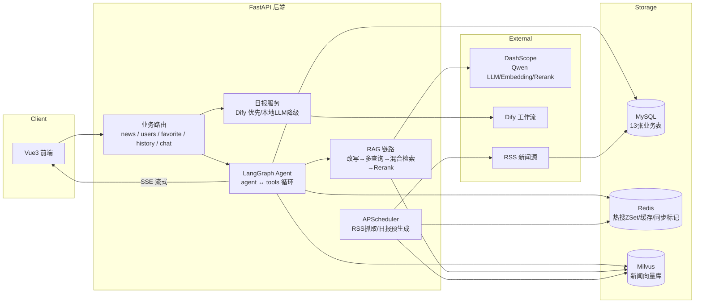

# 今日热点 · Toutiao AI

> AI 增强的新闻聚合与智能问答平台 —— 仿今日头条的全栈新闻系统，内置基于 **LangGraph Agent + RAG** 的智能问答助手。

     

## 核心亮点

- **ReAct Agent 对话**：基于 LangGraph 状态图构建 agent ↔ tools 循环，LLM 自主决策调用新闻检索 / 热搜榜 / 个人收藏等业务工具，闲聊零检索开销；SSE 流式输出
- **多级 RAG 链路**：多轮问题改写 → 多查询扩展召回 → **BM25 + 向量混合检索（RRF 融合）** → Rerank 精排，解决专有名词 / 型号类查询纯向量召回差的问题
- **质量保障闭环**：RAGAS 黄金评测集 + 回归基线（context_precision 1.0）、LangSmith 全链路追踪、用户点踩反馈（唯一约束 + upsert 幂等）→ 归因检索或生成
- **向量数据管道**：Milvus 语义检索，APScheduler 定时抓取多源 RSS 自动去重入库，Embedding 分批向量化 + Redis 标记增量同步保证幂等
- **平台集成与降级**：FastAPI 对接 Dify 工作流生成 AI 新闻日报，平台故障时自动降级本地 LLM，功能零中断
- **完整业务系统**：JWT 认证、收藏 / 浏览历史、基于浏览历史的个性化推荐、Redis ZSet 实时热搜、接口限流、统一响应与全局异常、pytest 回归测试

## 功能模块

32+ 接口、13 张表，覆盖新闻产品核心闭环：

| 模块 | 功能 |
|---|---|
| 用户 | 注册 / 登录（JWT + bcrypt 密码加密）/ 登录态鉴权 |
| 新闻 | 分类浏览 / 详情 / 分页 / 语义搜索 / 相关推荐 |
| 收藏 | 添加 / 取消 / 列表 / 清空（user_id + news_id 复合唯一约束防重复收藏） |
| 历史 | 浏览记录自动落库 / 个人历史清理 |
| 热搜 | Redis ZSet 实时榜单，浏览行为实时加权 |
| 推荐 | 基于浏览历史的向量相似推荐，未登录自动热点兜底 |
| AI 对话 | 多会话管理 / SSE 流式输出 / 引用来源展示 / 点赞点踩反馈 |
| AI 日报 | 定时预生成，Dify 工作流优先，本地 LLM 降级，Redis 缓存秒回 |
| 内容生产 | 多源 RSS 定时抓取 / 标题去重 / 自动向量化 / 新闻源管理 |

## 架构



### RAG / Agent 检索链路

```mermaid
flowchart TD
    Q[用户问题 + 多轮历史] --> W[问题改写<br/>Condense Question]
    W --> MQ[多查询扩展<br/>MultiQueryRetriever 向量召回]
    W --> BM[BM25 词面召回<br/>jieba 分词 + rank_bm25]
    MQ --> F[RRF 融合<br/>score = Σ 1/(60+rank)]
    BM --> F
    F --> RE[Rerank 精排<br/>Qwen text-rerank]
    RE --> GEN[LLM 生成 + 引用来源]
    GEN -->|SSE| OUT[流式输出 sources/content/done]
```

## 快速开始

### 环境要求

- Python 3.10+（开发环境 3.13）
- MySQL 8 / Redis / Milvus 2.4+（向量库）
- DashScope API Key（[申请地址](https://dashscope.console.aliyun.com/)，用于 Qwen LLM / Embedding / Rerank）

### 安装与启动

```bash
# 1. 安装依赖
python -m venv venv
venv\Scripts\activate                # Windows
pip install -r toutiao_backend/requirements.txt

# 2. 配置环境变量：复制模板并填入自己的 Key
#    在项目根目录创建 .env（模板见下文）

# 3. 初始化数据库：先执行建表脚本，再运行增量迁移
mysql -u root -p < toutiao_backend/db/database.sql
python toutiao_backend/utils/run_migration.py

# 4. 初始化新闻向量库（首次执行一次即可）
python toutiao_backend/utils/build_news_vector.py

# 5. 启动服务
cd toutiao_backend
..\venv\Scripts\python.exe -m uvicorn main:app --reload
```

浏览器访问 <http://127.0.0.1:8000> 即可体验（新闻浏览 / 语义搜索 / AI 对话 / 登录注册）。

### .env 模板

```env
# 大模型（DashScope 兼容 OpenAI 协议）
DASHSCOPE_API_KEY=sk-xxx
DASHSCOPE_BASE_URL=https://dashscope.aliyuncs.com/compatible-mode/v1
CHAT_MODEL_NAME=qwen-plus
EMBEDDING_MODEL_NAME=text-embedding-v3
RERANK_ENABLED=true
RERANK_MODEL=qwen3.7-text-rerank
RETRIEVE_TOP_K=5

# 向量库
MILVUS_URI=http://localhost:19530
MILVUS_COLLECTION=news_vector

# 对话记忆
CHAT_HISTORY_MAX_TURNS=6
CHAT_HISTORY_EXPIRE=3600

# LangSmith 全链路追踪（可选）
LANGSMITH_TRACING=true
LANGSMITH_API_KEY=lsv2_xxx
LANGSMITH_PROJECT=toutiao-rag-v1

# Dify 新闻日报工作流（可选，未配置时自动使用本地 LLM 降级）
DIFY_API_BASE=http://localhost/v1
DIFY_DAILY_REPORT_KEY=app-xxx
```

## 质量与评测

```bash
# RAGAS 评测回归：改动检索参数 / 换模型 / 改 prompt 前后各跑一次，对比 JSON 报告
python utils/eval_rag.py     # 全量 14 条黄金集
python utils/eval_rag.py 5   # 快速回归

# pytest 接口回归
pytest tests/ -v
```

基线报告见 `results/`（context_precision 1.0 / context_recall 1.0 / answer_relevancy 0.77）。
开启 LangSmith 后，每轮对话在 [smith.langchain.com](https://smith.langchain.com) 可查看完整 trace：每个环节的延迟、token 消耗与 prompt 全文。

## 项目结构

```
toutiao_backend/
├── main.py                  # 应用入口：路由挂载 / 限流 / CORS / 静态资源
├── routers/                 # 接口层：news / users / favorite / history / chat
├── services/
│   ├── chat_graph.py        # LangGraph Agent（agent ↔ tools 循环 + SSE 流式）
│   ├── agent_tools.py       # 业务工具：新闻检索 / 热搜榜 / 个人收藏
│   ├── rag_service.py       # RAG 链路：改写→多查询→混合检索→Rerank
│   ├── hybrid_retriever.py  # BM25+向量混合检索（RRF 融合）
│   ├── daily_report_service.py  # AI 日报：Dify 优先 / 本地 LLM 降级
│   ├── news_fetcher.py      # RSS 抓取 + 去重入库
│   └── vector_service.py    # Milvus 向量化（分批 + 增量同步）
├── crud/  models/  schemas/ # 数据访问 / ORM / Pydantic 校验
├── config/                  # 数据库 / 缓存 / AI 配置
├── migrations/              # 增量迁移 SQL（幂等可重跑）
├── tests/                   # pytest 回归 + RAGAS 黄金评测集
├── utils/eval_rag.py        # RAGAS 评测脚本
├── db/database.sql          # 建表与种子数据
└── static/                  # Vue3 前端（免构建，FastAPI 直接托管）
```

## Roadmap

- [ ] Tavily 联网搜索工具：本地库未命中时 Agent 自动联网兜底
- [ ] 个人知识库：上传 PDF / DOCX 构建用户专属向量空间（共享 collection + user_id 过滤）
- [ ] 父子分块：小块检索、大块生成
- [ ] 语义缓存：相似问题命中历史答案，降低 LLM 成本

---

*个人学习项目，欢迎交流。*
